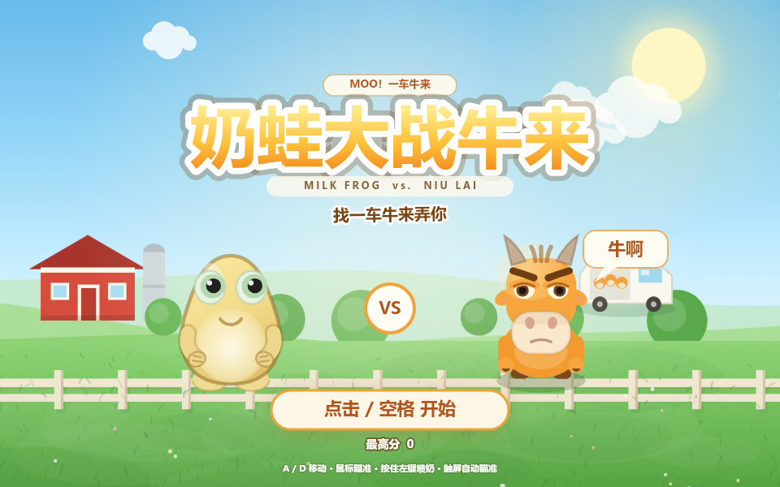
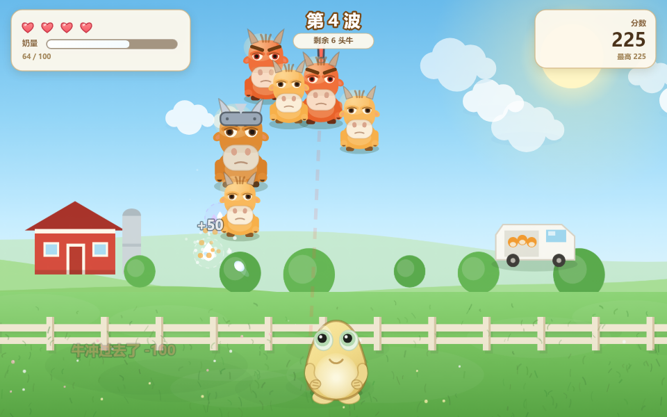
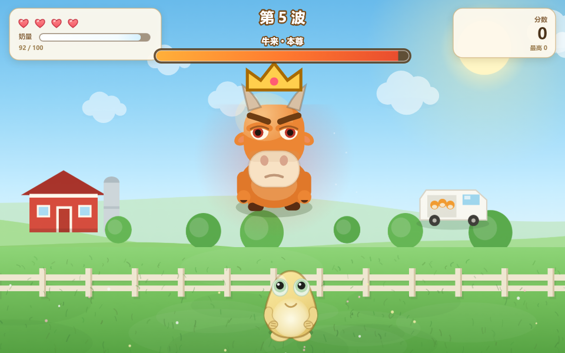
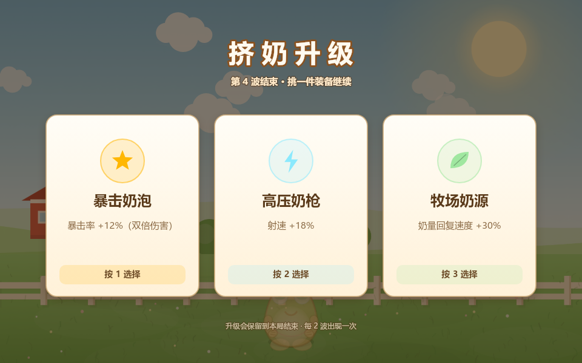
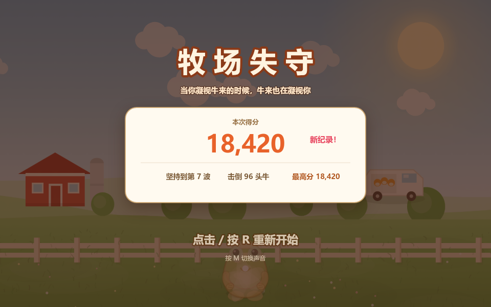

# 奶蛙大战牛来 · Milk Frog vs. Niu Lai

第二版：按参考图重做的「奶蛙 × 牛来」主题。
奶蛙变成黄色团子，牛来变成橘色大嘴牛，场景换成白天牧场；玩法与上一版基本一致。



## 运行

- 直接双击 `index.html`，用 Chrome / Edge / Firefox 打开即可（推荐 F11 全屏）。
- 也可以起本地服务：

  ```bash
  python -m http.server 8000
  ```

  然后访问 <http://localhost:8000>。

> 直接双击时浏览器可能限制 `localStorage`，最高分不一定保存；用本地服务或 http 打开就能正常记录。

## 操作

| 操作 | 按键 |
| --- | --- |
| 左右移动 | `A` / `D` 或 `←` / `→` |
| 瞄准 | 鼠标移动 |
| 喷奶 | 按住鼠标左键 / 空格 |
| 暂停 | `P` / `Esc` |
| 静音 | `M` |
| 重新开始 | 结算后按 `R` 或点击 |
| 选升级 | 点击卡片，或按 `1` / `2` / `3` |

触屏：按住屏幕拖动即可移动，准星会自动锁定最近的牛并开火。

## 玩法

- **奶量**：射击消耗奶量，停火后自动回复。奶量见底开不了火，记得留一口。
- **连击**：短时间内连续击杀提高得分倍率，最高 ×3.4。
- **掉落**：奶滴、大瓶奶、生命、三连奶（10 秒三发）、奶盾（挡一次伤害）。
- **升级**：每 2 波（以及牛来波之后）三选一，永久保留到本局结束。
- **牛来本尊**：第 5、10、15… 波出现，会召小牛、吐牛气弹、锁定位置冲撞。看到地面红色预警柱就赶紧挪窝。
- **牛冲过去**会扣 100 分并打断连击，别光顾着躲。



## 牛来图鉴

| 牛 | 特点 |
| --- | --- |
| 牛犊 | 跑得快、血少 |
| 壮牛 | 标准单位，血厚一点 |
| 疯牛 | 红眼，锁定后沿红色虚线直线冲锋 |
| 铁头牛 | 戴铁护额，血很厚、走得慢 |
| 牛来本尊 | 戴皇冠的那位，第 5 波起登场 |



## 彩蛋

- 标题页的「找一车牛来弄你」「牛啊」气泡，还有远处那辆装着三头牛的面包车。
- 结算页的「当你凝视牛来的时候，牛来也在凝视你」。
- 升级界面：
- 结算界面：

## 额外调试参数

在地址后面加参数可以直接跳到指定状态：

- `?auto=1&wave=8`：直接从第 8 波开始
- `?boss=1`：直接开牛来本尊
- `?demo=1`：自动瞄准自动开火的演示模式（无敌）
- `?upgrade=1`：直接打开升级界面
- `?over=1`：直接看结算界面

## 技术实现

- 单个 `index.html`，Canvas 2D 绘制，WebAudio 实时合成音效。
- 固定 960×600 逻辑分辨率，按窗口等比缩放并适配高 DPI。
- 60 FPS 主循环，帧间 `dt` 上限 50ms，切后台自动暂停。
- 不使用任何第三方库或外部资源，离线可玩。

## 说明

角色形象参考网络表情包「奶蛙」「牛来」做的同人二创，仅作娱乐，非官方作品。
上一版（绿色青蛙 + 棕色牛、夜晚牧场）仍在 `milk-frog-vs-bulls/` 目录。
